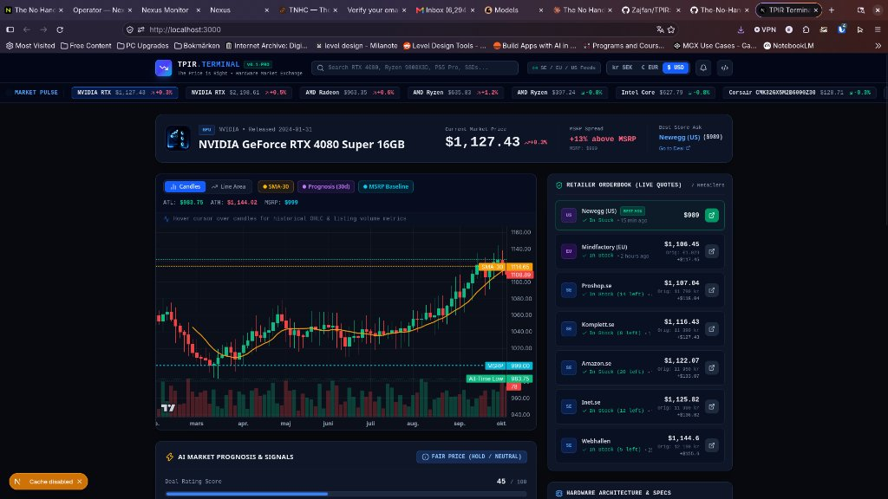

# TPIR (The Price is Right) 📈
### Hardware Market Financial Terminal & Price Prognosis Engine

[](LICENSE)
[](https://nextjs.org)
[](https://tradingview.github.io/lightweight-charts/)
[]()

> **The Price is Right (TPIR)** is an open-source financial trading terminal for computer hardware and consumer electronics. Instead of trading stocks, users track **GPUs, CPUs, RAM, SSDs, HDDs, Servers, and Gaming Consoles** to know precisely when to enter the market and buy when the price is right.



---

## ⚡ Why TPIR?

Computer hardware prices fluctuate violently across crypto cycles, NAND/DRAM production gluts, generational refreshes, and seasonal retailer gouging. 

Traditional price trackers merely show a basic line graph. **TPIR brings the depth of a Bloomberg Terminal / TradingView exchange** to PC enthusiasts and builders:
- **Candlestick / OHLC Visualizer**: Intraday hour-by-hour (1H/24H) to full lifecycle (ALL) high, low, open, close, and listing volume.
- **Hardware Technical Indicators**: Simple Moving Averages (SMA-30), MSRP Baselines, and Hardware Relative Value Index (RVI).
- **AI Price Prognosis Engine**: Forecasts 30-day price trajectories and computes a **Deal Score (0–100)** to classify items into *Strong Buy, Good Deal, Fair Price, Overpriced,* or *Don't Buy / Scalped*.
- **Truth Index & Fake Discount Radar**: Flags artificial pre-sale price hikes and calculates the true discount vs the real 90-day historical median.
- **Hardware Compare Arena**: Side-by-side battle between 2–3 products with price-to-performance metrics (e.g. FPS-per-kr, GB-per-kr) and a "Best Value Crown".
- **Portfolios & Multi-List Builder**: Track entire PC builds or server clusters with an aggregate basket total and **Split-Store Order Optimizer** (finding the cheapest store combination across Inet, Webhallen, Komplett, and Amazon.se).
- **Enterprise & Gamer TCO Power Calculator**: Estimates 1-year and 3-year running electricity costs based on TDP wattage and Swedish/EU power tariffs.
- **Multi-Currency (SEK, EUR, USD)**: Real-time currency conversions tailored for the Swedish market (**Inet, Webhallen, Komplett, Proshop, Amazon.se**) and global exchanges.
- **Target Buy Triggers ("Limit Orders")**: Set a buy price target and receive browser alerts when any retailer hits your price.

---

## 🖥️ Screen Layout & Features

1. **Market Ticker**: Real-time marquee bar showing top percentage gainers and drops across all categories.
2. **Interactive TradingView Chart (`lightweight-charts v5`)**:
   - Timeframe switching: `1H` (intraday hourly price wars), `24H`, `7D`, `1M`, `3M`, `1Y`, and `ALL` (from day-1 launch to EOL)
   - Candlestick & Area view toggle
   - 30-day Moving Average (SMA-30) overlay
   - Official MSRP Baseline
   - All-Time-Low (ATL) support marker
   - 30-day Prognosis projection trendline
   - Interactive hover legend displaying OHLC values
3. **Hardware Compare Arena**:
   - Side-by-side spec and value comparison
   - Value Ratio metric: Performance points per 1,000 SEK / 100 EUR / 100 USD
   - Direct winner recommendation
4. **Portfolios & Build Lists**:
   - Manage multiple named builds (*"Dream 4K Rig"*, *"Homelab Cluster"*)
   - Split-store order grouping minimizes your total checkout bill across retailers
5. **AI Market Prognosis & Signals**:
   - **Deal Rating Score (0 - 100)** with dynamic progress gauge
   - Truth Index Fake Discount Radar
   - Fair Value calculation vs Current Market Price
   - Hardware Relative Value Index (RVI)
   - Lifecycle stages: *Launch Spike, Mature Production, Price Bottom, Clearance, End-of-Life*
6. **Total Cost of Ownership (TCO) Calculator**:
   - 1-Year and 3-Year power consumption estimates for 4h/day, 8h/day, or 24/7 continuous operations
7. **Retailer Orderbook (Live Quotes)**:
   - Compares Swedish stores (**Inet.se, Webhallen, Komplett.se, Proshop.se, Amazon.se**) and international retailers (**Mindfactory, Newegg, Best Buy**)
   - Real-time stock counts and "BEST ASK" badge
   - Direct store links
8. **Hardware Market Heatmap**:
   - Category filtering: **GPUs, CPUs, RAM, SSDs, Consoles (PS5, Xbox, Switch), Servers & HDDs**
   - Sorting by best deal score, biggest price drop, or price

---

## 🚀 Quick Start

### Prerequisites
- [Node.js](https://nodejs.org/) (v18 or newer)
- npm or pnpm

### Installation

```bash
# Clone the repository
git clone https://github.com/your-username/TPIR.git
cd TPIR

# Install dependencies
npm install

# Start the local development terminal
npm run dev
```

Open [http://localhost:3000](http://localhost:3000) in your browser.

### Production Build

```bash
npm run build
npm run start
```

---

## 🛠️ Tech Stack

- **Framework**: [Next.js 16](https://nextjs.org) (App Router, Turbopack, React 19, TypeScript)
- **Styling**: [Tailwind CSS v4](https://tailwindcss.com) (Financial Terminal Dark Theme)
- **Charting Engine**: [TradingView Lightweight Charts v5](https://tradingview.github.io/lightweight-charts/)
- **Icons**: [Lucide React](https://lucide.dev)

---

## 🇸🇪 Swedish & Multi-Currency Engine

TPIR natively supports:
- **SEK (kr)**: Swedish Krona, formatted per Swedish conventions (`11 990 kr`)
- **EUR (€)**: Euro (`€1,029`)
- **USD ($)**: US Dollar (`$989`)

Toggle currencies with a single click in the top navigation bar; all charts, orderbooks, and trigger alerts update instantly.

---

## 📜 License

MIT License. Contributions, scrapers, and retailer connectors are warmly welcomed!
